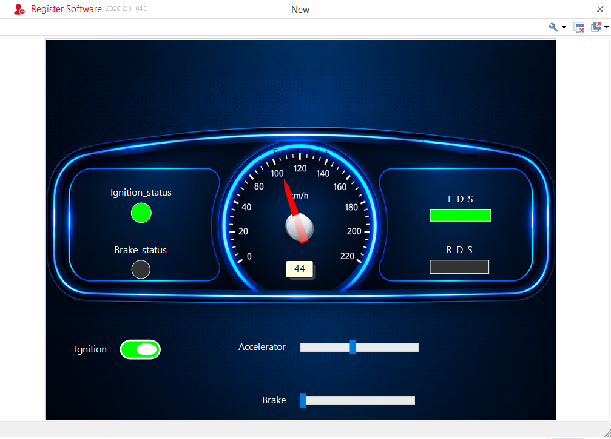
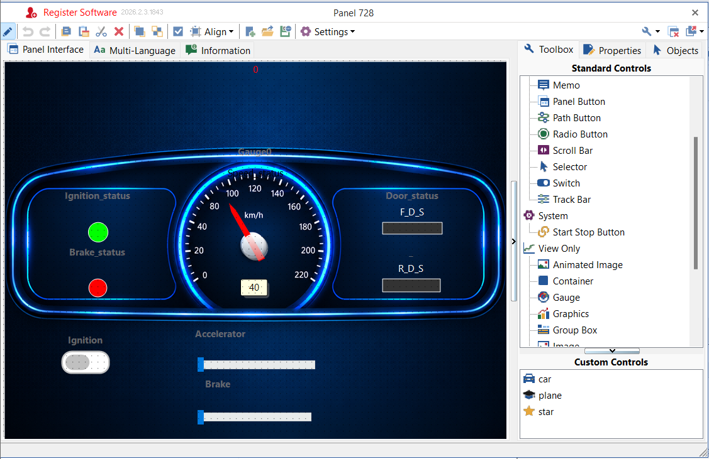
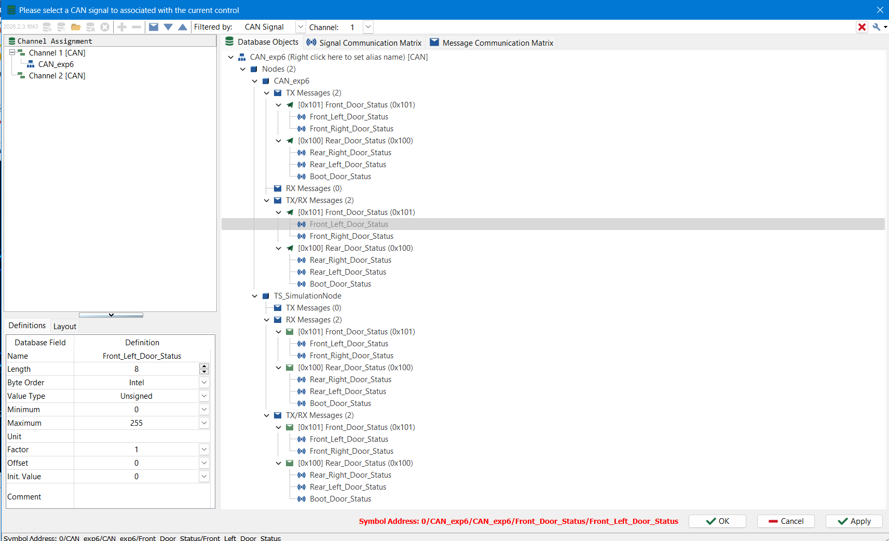
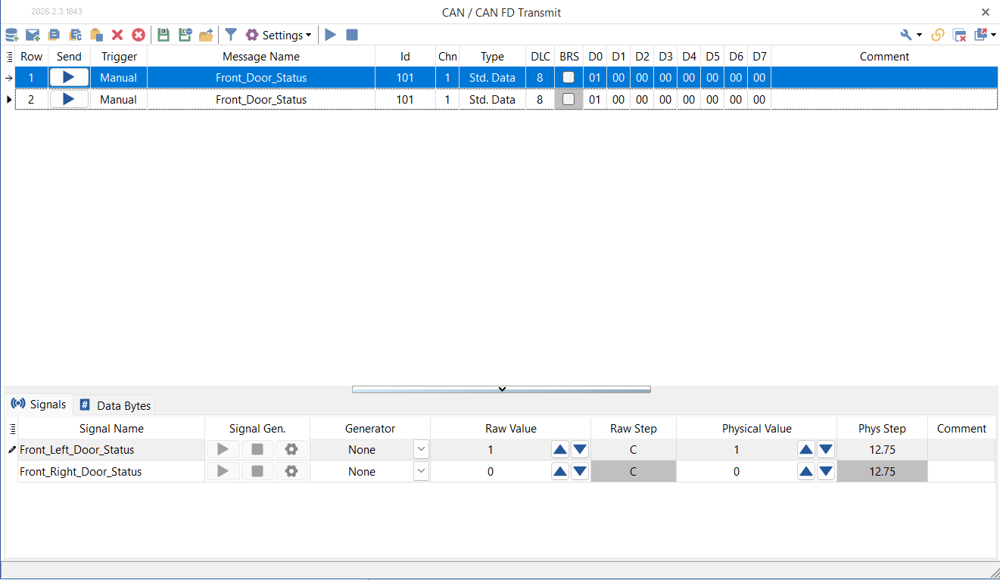
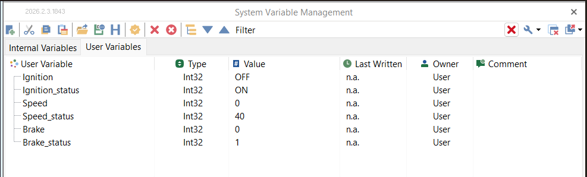
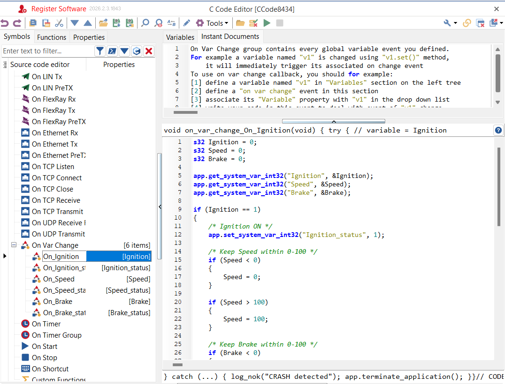

# Automotive CAN Dashboard Using TSMaster

### CAN-Based Vehicle Instrument Cluster Simulation

## Project Overview

The **Automotive CAN Dashboard** is a vehicle dashboard simulation developed using TSMaster and CANdb++. It demonstrates how vehicle-related signals can be configured, monitored, and displayed through a custom dashboard interface.

The dashboard includes ignition status, vehicle speed, brake status, and front and rear door status. TSMaster is used for dashboard design, system-variable handling, scripting, and CAN message transmission, while CANdb++ is used to define CAN messages and signals.

## Project Preview



*Figure 1: Final dashboard interface showing the speedometer, ignition and brake indicators, accelerator and brake controls, and door-status indicators.*

## Key Features

- Custom automotive dashboard interface with a speedometer.
- Ignition ON/OFF status indication.
- Speed value display and range validation.
- Brake status indication.
- Accelerator and brake slider controls.
- Front-door and rear-door status monitoring.
- CAN message and signal configuration using CANdb++.
- System-variable handling and event-driven C scripting in TSMaster.
- CAN message transmission and signal-value monitoring.

## Tools and Technologies

| Tool / Technology | Purpose |
|---|---|
| TSMaster | Dashboard development, scripting, system variables and CAN communication |
| CANdb++ | CAN message and signal database configuration |
| CAN / CAN FD | Vehicle communication concepts and message configuration |
| C scripting | Event-driven logic and variable handling |
| Automotive HMI | Vehicle-status visualization and user interaction |

## System Architecture

The project can be understood through the following workflow:

1. **CAN Database:** Define messages, signal names, identifiers and signal properties in CANdb++.
2. **System Variables:** Configure variables for ignition, speed, brake and door-status information.
3. **Control Logic:** Use TSMaster event handlers and C scripting to process variable changes.
4. **Dashboard Interface:** Display vehicle-related values and status indicators through a custom panel.
5. **CAN Testing:** Configure CAN messages and observe signal values during simulation or communication testing.

The exact connection between the dashboard variables and transmitted CAN signals depends on the configured mappings and runtime setup.

## Dashboard Interface

The dashboard contains the following elements:

- **Speedometer:** Displays the vehicle speed value.
- **Ignition Indicator:** Indicates the ignition state.
- **Brake Indicator:** Displays the configured brake status.
- **Accelerator Control:** Allows the accelerator-related input to be adjusted.
- **Brake Control:** Allows the brake-related input to be adjusted.
- **Front Door Status:** Displays the configured front-door signals.
- **Rear Door Status:** Intended for rear-door signal monitoring.



*Figure 2: Dashboard panel design in TSMaster.*

## CAN Database Configuration

CANdb++ is used to organize vehicle messages and their associated signals.

The configured front-door message includes:

| Parameter | Configuration |
|---|---|
| Message name | Front_Door_Status |
| CAN identifier | 0x101 |
| Message type | Standard data frame |
| DLC | 8 bytes |
| Signals | Front_Left_Door_Status, Front_Right_Door_Status |

The rear-door message is configured with the identifier `0x100` and includes rear-right, rear-left and boot-door status signals.



*Figure 3: CAN database signal definitions and message associations.*

## CAN Message Testing

TSMaster's CAN transmit window is used to configure and inspect message data.



*Figure 4: Front-door CAN message configuration with signal values and data bytes.*

The displayed configuration uses CAN ID `0x101`, a standard data frame, and an eight-byte payload. The visible data values represent the configured message state; actual bus transmission should be verified in the running setup.

## System Variables and Control Logic

System variables provide a way to represent vehicle-related information within the application.

The configured variables include:

- `Ignition`
- `Ignition_status`
- `Speed`
- `Speed_status`
- `Brake`
- `Brake_status`



*Figure 5: System Variable Management window.*

The C scripting implementation includes variable-change handling for ignition, speed and brake values. The visible speed-handling logic checks the range and constrains the value to between 0 and 100.



*Figure 6: C Code Editor showing variable-change handling and input validation.*

## Testing and Validation

The following test cases can be used to validate the dashboard:

| Test case | Input / action | Expected result |
|---|---|---|
| Ignition ON | Set ignition to ON | Ignition indicator shows ON |
| Ignition OFF | Set ignition to OFF | Ignition indicator shows OFF |
| Speed minimum | Set speed below 0 | Speed is constrained to 0, if the shown logic is active |
| Speed maximum | Set speed above 100 | Speed is constrained to 100, if the shown logic is active |
| Brake status | Change the brake variable | Brake indicator follows the configured logic |
| Front door | Change front-door signal values | Corresponding door-status display updates if mapped |
| Rear door | Change rear-door signal values | Corresponding rear-door display updates if mapped |
| CAN message | Configure and transmit the front-door message | Verify the configured ID and payload in the communication monitor |

*Note: Expected results should be marked as passed only after the corresponding behavior has been tested.*

## Repository Structure

```text
automotive-can-dashboard-tsmaster/
├── README.md
├── images/
│   ├── dashboard-ui.png
│   ├── dashboard-design.png
│   ├── can-database.png
│   ├── can-transmit.png
│   ├── c-script.png
│   └── system-variables.png
├── can-database/
│   └── README.md
├── scripts/
│   └── README.md
├── test-results/
│   └── README.md
├── .gitignore
└── LICENSE
```

## How to Explore the Project

1. Clone or download this repository.
2. Open `README.md` to review the project workflow and screenshots.
3. Review the CAN database and scripts folders for any shared project files.
4. Open the relevant project files in a compatible TSMaster environment, if provided.
5. Configure the appropriate CAN channel and verify signal mappings before running communication tests.

TSMaster project files, CAN database files and scripts are not included unless explicitly uploaded to the repository.

## Learning Outcomes

- Understanding automotive CAN messages and signal definitions.
- Working with CAN identifiers, data length and payload values.
- Creating a dashboard interface for vehicle-status monitoring.
- Using system variables and event-driven scripting.
- Understanding signal mapping between a CAN database and dashboard controls.
- Practising structured testing of automotive interface behavior.

## Future Improvements

- Integrate additional vehicle signals such as temperature, battery voltage and motor speed.
- Add rear-door and boot-door status visualization.
- Implement periodic CAN message transmission where required.
- Add signal timeout detection and communication error indications.
- Extend testing with a physical CAN interface or ECU, if available.

## Author

**Sarukesh D**

Electrical and Electronics Engineering Student

Interests: Automotive Embedded Systems, CAN Communication, Embedded C and Vehicle Electronics.

---

*This project is intended for learning and simulation. It is not a certified automotive instrument cluster or a safety-critical vehicle control system.*
